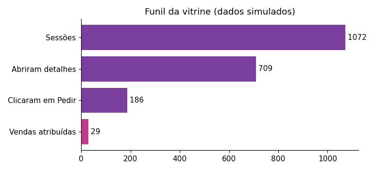

# EntreLaços — pipeline de catálogo e análise de funil

Projeto de portfólio em **Python** que mantém o catálogo de uma vitrine de presentes em um CSV, valida os dados,
gera o site estático e analisa o funil visita → detalhes → pedido → venda, com relatório e gráficos.



> **Estado honesto**
> - **Ninguém usa a vitrine.** Não há tráfego nem vendas reais; os eventos e as vendas de `data/*_demo.csv` são
>   **simulados** (semente fixa, premissas em `entrelacos/simulacao.py`). Os números do relatório refletem essas
>   premissas, não o mercado: o que o projeto demonstra é o **pipeline**, não um resultado de negócio.
> - O site **não coleta eventos** hoje. O esquema que uma coleta teria está em [`docs/esquema-de-eventos.md`](docs/esquema-de-eventos.md).
> - O front foi exercitado em DOM simulado (jsdom) e por testes, **não** em navegador real. A configuração da Vercel
>   (`outputDirectory: site`) não foi testada em deploy; se necessário, defina *Root Directory = site* no painel.

## O que o pipeline faz

```
data/catalogo.csv ──► validar ──► build ──► site/products.json  (+ site/config.json)
        │                                         └─ o site (HTML/CSS/JS) lê só esses arquivos
        └─ regras: id único, preço > 0, preço antigo > preço, imagem existe,
           categorias "até R$ 100" e "premium" derivadas do preço (não digitadas)

simulacao ──► data/eventos_demo.csv + vendas_demo.csv ──► qualidade ──► métricas ──► reports/relatorio.md + PNG
```

- **Fonte única do catálogo:** antes, os produtos existiam em dois lugares (`products.json` e uma cópia dentro do
  `script.js`), e editar só um deles mostraria preço errado se o `fetch` falhasse. Agora há só o CSV; o JSON é gerado e a CI
  falha se estiver fora de sincronia.
- **Qualidade de dados:** 11 checagens em eventos e vendas (ids duplicados, produto inexistente, sessão sem visita,
  venda órfã, venda anterior ao clique…), todas cobertas por teste.
- **Atribuição:** cada clique em "Pedir" gera um código `EL-XXXX` na mensagem do WhatsApp. Se o vendedor anotar o código
  da venda, clique e venda se ligam. O relatório mostra a **cobertura de receita atribuída** (o que não dá para ligar).

## Como rodar

```bash
python -m venv .venv && source .venv/bin/activate    # Windows: .venv\Scripts\activate
pip install -r requirements.txt

python -m entrelacos tudo        # validar + build + demo + analisar
python -m unittest discover -s tests -v
```

| Comando | O que faz |
|---|---|
| `python -m entrelacos validar` | valida `data/catalogo.csv` e a configuração |
| `python -m entrelacos build` | gera `site/products.json` e `site/config.json` |
| `python -m entrelacos demo` | gera dados **simulados** (semente fixa) |
| `python -m entrelacos analisar` | checa a qualidade e escreve `reports/` |

Para ver o site: `python -m http.server -d site 8000` e abrir `http://localhost:8000`.

## Configuração do WhatsApp
O repositório usa um **número marcador** (`55XXXXXXXXXXX`). Para publicar, defina antes do `build`:
`WHATSAPP_NUMBER=5511999999999` e, opcionalmente, `SELLER_NAME=Nome`. O `validar` avisa se o número não estiver no formato.

## Estrutura
```
entrelacos/   catalogo · simulacao · qualidade · metricas · relatorio · CLI (Python)
data/         catalogo.csv (fonte) · config.json · eventos_demo.csv · vendas_demo.csv (simulados)
reports/      relatorio.md e gráficos gerados
site/         vitrine estática (saída): HTML, CSS, JS e imagens
tests/        22 testes (unittest)
docs/         esquema de eventos e regras de atribuição
.github/      CI: testes, sincronia do JSON, reprodutibilidade dos dados, relatório e sintaxe do JS
```

## Limites conhecidos
- Vendas sem código (cliente apagou, ou comprou depois por outro canal) não são atribuíveis.
- O vendedor precisaria registrar cada venda numa planilha para fechar o ciclo; sem isso só existe funil de intenção.
- Amostra pequena não sustenta testes estatísticos entre produtos.
- O preço "De/Por" precisa ser um preço anterior real (Código de Defesa do Consumidor).

## Origem
Vitrine HTML/CSS/JS feita para um vendedor de presentes; reformulada como projeto de dados e automação.
Marcas e produtos pertencem aos respectivos fabricantes; uso demonstrativo, sem fins comerciais.
