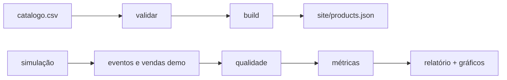

<div align="center">


**🎀 &nbsp;Vitrine digital de presentes com atendimento pelo WhatsApp&nbsp; 🎀**

<table>
<tr>
<td align="center">

<br><sub>Catálogo e pedido</sub>
</td>
<td align="center">

<br><sub>Validação e build</sub>
</td>
<td align="center">

<br><sub>Métricas e relatório</sub>
</td>
</tr>
</table>

<br>

<a href="https://entrelacos-vitrine.vercel.app"></a>

<br><br>


</div>

## 💝 Sobre o projeto

Um colega de classe revende kits de marcas conhecidas e divulgava tudo em fotos soltas e mensagens. O cliente precisava perguntar preço, detalhes e disponibilidade um a um.

O **EntreLaços** reúne os kits numa vitrine organizada. O cliente escolhe, toca em **Pedir** e continua a conversa no WhatsApp com a mensagem já montada. Depois que virou projeto de portfólio, ganhou um pipeline em Python que valida o catálogo, gera o site e analisa o funil de intenção.

| Problema | Solução | Tecnologias |
|---|---|---|
| Divulgação espalhada em fotos e mensagens, com escolha difícil e atendimento repetitivo | Vitrine estática com filtros e detalhes, mais pipeline que valida o catálogo e analisa o funil *visita → detalhes → pedido → venda* |     |


## 🚦 Estado do projeto

| Item | Situação |
|---|---|
| Vitrine publicada | ✅ Online na Vercel |
| Uso real | ✅ Houve uso. Atendimento e pagamento aconteciam no WhatsApp, fora do site |
| Dados reais | 🔒 Removidos por privacidade, principalmente as conversas de atendimento |
| Dados do relatório | 🧪 **Simulados** (semente fixa, premissas em `entrelacos/simulacao.py`), sem relação com as vendas reais |
| Coleta de eventos no site | ❌ Não implementada. Esquema previsto em [`docs/esquema-de-eventos.md`](docs/esquema-de-eventos.md) |
| Testes do front | ⚠️ Em DOM simulado (jsdom), não em navegador real |
| Config da Vercel | ⚠️ `outputDirectory: site` não testado em deploy. Se falhar, use *Root Directory = site* |


## ⚙️ Como funciona



<div align="center">
  <br>
  <sub>Funil gerado com dados <b>simulados</b></sub>
</div>


## 🧠 Decisões técnicas

| Decisão | Por quê |
|---|---|
| **CSV como fonte única** | Antes os produtos existiam em dois lugares (`products.json` e cópia no `script.js`), e editar só um mostrava preço errado. Agora o JSON é gerado e a CI falha se sair de sincronia |
| **Categorias derivadas do preço** | "Até R$ 100" e "premium" não são digitadas, então não ficam inconsistentes |
| **Validação antes do build** | Id único, preço > 0, preço antigo > preço, imagem existente |
| **11 checagens de qualidade** | Ids duplicados, produto inexistente, venda órfã, venda anterior ao clique etc., todas com teste |
| **Código `EL-XXXX` no pedido** | Liga clique e venda se o vendedor anotar o código. O relatório mostra a **cobertura de receita atribuída** |
| **Site estático** | Sem backend para manter ou pagar, suficiente para um catálogo pequeno |


## 🧩 Competências aplicadas

<div align="center">

| Área | Aplicação no projeto |
|:---:|---|
| 🗃️ **Qualidade de dados** | Validação do catálogo e 11 checagens em eventos e vendas |
| 🔗 **Atribuição** | Ligação entre clique e venda por código no pedido |
| 📊 **Análise de funil** | Métricas de conversão, relatório e gráficos |
| ⚙️ **Automação** | CI com testes, sincronia do JSON e reprodutibilidade dos dados |
| 🎨 **Front-end** | Vitrine estática responsiva, com filtros, detalhes e pedido por WhatsApp |

</div>


## ▶️ Como rodar

```bash
python -m venv .venv && source .venv/bin/activate    # Windows: .venv\Scripts\activate
pip install -r requirements.txt

python -m entrelacos tudo                  # validar + build + demo + analisar
python -m unittest discover -s tests -v    # 22 testes
```

| Comando | O que faz |
|---|---|
| `python -m entrelacos validar` | Valida `data/catalogo.csv` e a configuração |
| `python -m entrelacos build` | Gera `site/products.json` e `site/config.json` |
| `python -m entrelacos demo` | Gera dados simulados |
| `python -m entrelacos analisar` | Checa a qualidade e escreve `reports/` |

Para ver o site: `python -m http.server -d site 8000` e abrir `http://localhost:8000`.

<details>
<summary><b>📲 Configurar o WhatsApp</b></summary>

<br>

O repositório usa um número marcador (`55XXXXXXXXXXX`) por privacidade. Antes do `build`:

```bash
export WHATSAPP_NUMBER=5511999999999   # DDI + DDD + número, sem espaços
export SELLER_NAME="Nome"              # opcional
```

O `validar` avisa se o formato estiver errado.

</details>

<details>
<summary><b>🗺️ Estrutura do repositório</b></summary>

<br>

| Pasta | Conteúdo |
|---|---|
| `entrelacos/` | catálogo, simulação, qualidade, métricas, relatório e CLI |
| `data/` | `catalogo.csv` (fonte), `config.json`, dados `*_demo.csv` |
| `reports/` | relatório e gráficos gerados |
| `site/` | vitrine estática (saída do build) |
| `tests/` | 22 testes (`unittest`) |
| `docs/` | esquema de eventos e regras de atribuição |
| `.github/` | workflows da CI |

</details>


## 🚧 Limites conhecidos

- Vendas sem código (cliente apagou a mensagem ou comprou por outro canal) não são atribuíveis.
- Sem o vendedor registrar as vendas numa planilha, só existe funil de **intenção**.
- Amostra pequena não sustenta testes estatísticos entre produtos.
- O preço "De/Por" precisa ser um preço anterior real (Código de Defesa do Consumidor).

## 📌 Sobre os dados

Os dados reais de atendimento foram removidos por privacidade. Eventos e vendas do relatório são simulados e demonstram o pipeline, não conclusões sobre o negócio. Marcas e produtos pertencem aos respectivos fabricantes, com uso demonstrativo e sem fins comerciais.

<div align="center">

Feito por **[Max Godoy](https://github.com/maxgodoydev)** 💜


</div>
