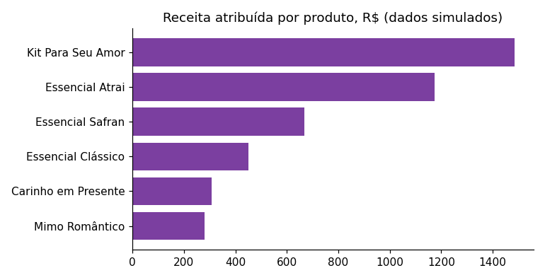
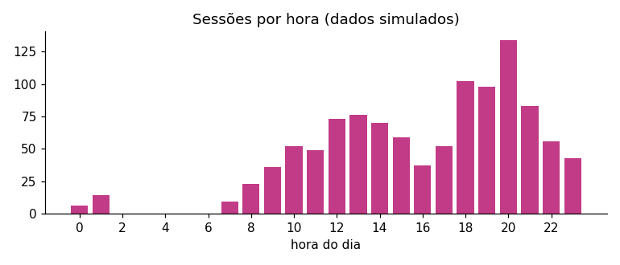

# Relatório da vitrine EntreLaços

> **DADOS SIMULADOS.** Gerados por `entrelacos/simulacao.py` com semente fixa. Os números abaixo refletem as
> premissas do simulador e **não** são resultado de mercado. O objetivo é demonstrar o pipeline (qualidade,
> atribuição, métricas e relatório), não tirar conclusões sobre vendas reais.

## Funil

| etapa | quantidade | taxa |
|---|---|---|
| Sessões | 1072 |  |
| Abriram detalhes | 709 | 66,1% das sessões |
| Clicaram em Pedir | 186 | 17,4% das sessões |
| Vendas atribuídas (código casou com clique) | 29 | 15,6% dos cliques |
| Vendas sem código / sem clique | 16 | não atribuíveis |

- Receita total registrada: **R$ 6.321,50**; atribuída a um clique: **R$ 4.366,10**
  (cobertura de **69,1%**). O restante não tem como ser ligado a um clique.

## Por produto

| produto | preco | desconto_pct | sessoes_abriram | sessoes_pediram | taxa_pedido_pct | vendas_atribuidas | receita_atribuida |
|---|---|---|---|---|---|---|---|
| Kit Para Seu Amor | 134,90 | 10,00 | 223 | 53 | 22,00 | 11 | 1483,90 |
| Essencial Atrai | 234,90 | 9,60 | 172 | 26 | 12,20 | 5 | 1174,50 |
| Essencial Safran | 222,90 | 7,10 | 135 | 17 | 8,90 | 3 | 668,70 |
| Essencial Clássico | 225,90 | 9,60 | 148 | 22 | 14,90 | 2 | 451,80 |
| Carinho em Presente | 76,90 | 14,50 | 183 | 37 | 17,50 | 4 | 307,60 |
| Mimo Romântico | 69,90 | 17,70 | 206 | 31 | 12,60 | 4 | 279,60 |

## Por origem do tráfego

| origem | sessoes | sessoes_pediram | vendas_atribuidas | receita_atribuida | taxa_pedir_pct |
|---|---|---|---|---|---|
| instagram | 491 | 74 | 12 | 1752,80 | 15,10 |
| whatsapp_status | 263 | 43 | 6 | 812,40 | 16,30 |
| direto | 160 | 26 | 6 | 984,40 | 16,20 |
| indicacao | 158 | 43 | 5 | 816,50 | 27,20 |

## Quando as pessoas visitam

Sessões por dia da semana: seg 133, ter 144, qua 125, qui 123, sex 174, sáb 174, dom 199.

## Qualidade dos dados

Nenhum problema encontrado.

## Como ler

- Venda atribuída exige que o vendedor registre o `codigo_pedido` (EL-XXXX) enviado na mensagem do WhatsApp.
- Amostra pequena: poucas dezenas de vendas não sustentam testes estatísticos entre produtos.
